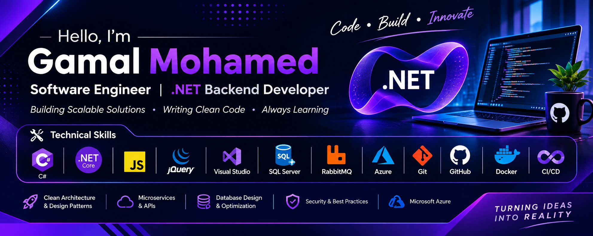

# 👋 Hi, I'm Gamal Mohamed

### 💻 Software Engineer & .NET Backend Developer

&nbsp;

*“Building scalable applications, designing reliable systems, and solving complex problems.”*

---

## 👨‍💻 About Me

I am a Software Engineer specializing in **.NET Backend Development**, passionate about designing and developing scalable, secure, and maintainable software solutions. My core focus lies in robust backend engineering, API development, database architecture, system integration, and distributed systems.

- 💼 **Current Role:** Software Developer at **SoftTrend**
- 🛠️ **Core Stack:** C#, ASP.NET Core, Entity Framework Core, SQL Server
- 📐 **Interests:** Distributed architectures, microservices, and asynchronous messaging
- 🚀 **Goal:** Continuously building high-performance backend systems and scaling my software engineering expertise

---

## 🛠️ Technical Skills

### ⚡ Core Tech Stack

  

 

| Domain | Technologies & Badges |
| :--- | :--- |
| **Languages** |    |
| **Backend & APIs** |      |
| **Data & Messaging** |   |
| **Frontend** |     |
| **Cloud & DevOps** |     |

> **Architecture & Engineering:** Clean Architecture • SOLID Principles • Design Patterns • Microservices • Distributed Systems • Asynchronous Messaging • Event-Driven Architecture • RESTful API Design

---

## 🚀 Featured Projects

### 🛒 01. E-Commerce Marketplace
- **Description:** Developed robust backend systems and integrated seamless marketplace workflows with Microsoft Partner Center.
- **Tech Stack:** ASP.NET Core MVC • C# • Entity Framework Core • SQL Server • REST APIs

### 🐇 02. RabbitMQ Messaging System
- **Description:** Implemented high-reliability asynchronous messaging and distributed component communication.
- **Key Features:** Publisher Confirms, Consumer Acknowledgments, Direct Exchanges, Message Persistence, TTL, and Dead Letter Exchanges (DLX).
- **Tech Stack:** C# • .NET • RabbitMQ

### 📊 03. Dynamic Sales Dashboard
- **Description:** Built an interactive reporting dashboard supporting dynamic filters and rich data visualization.
- **Tech Stack:** ASP.NET Core MVC • Entity Framework Core • SQL Server • Chart.js
- [🔗 View Repository](https://github.com/GamalMo7amed/DynamicChartDashboard)

### 💬 04. Real-Time Chat Application
- **Description:** Designed a real-time messaging application demonstrating efficient server-client socket/backend communication patterns.
- [🔗 View Repository](https://github.com/GamalMo7amed/ChatApplication)

---

## 📚 Currently Exploring & Learning

- ☁️ Advanced Cloud-Native Applications & Microservices
- 📐 Enterprise Distributed Systems & System Design Patterns
- ⚡ Advanced Event-Driven Architecture

---

## 🤝 Let's Connect

### **Gamal Mohamed** — Software Engineer | .NET Backend Developer

&nbsp;

  

