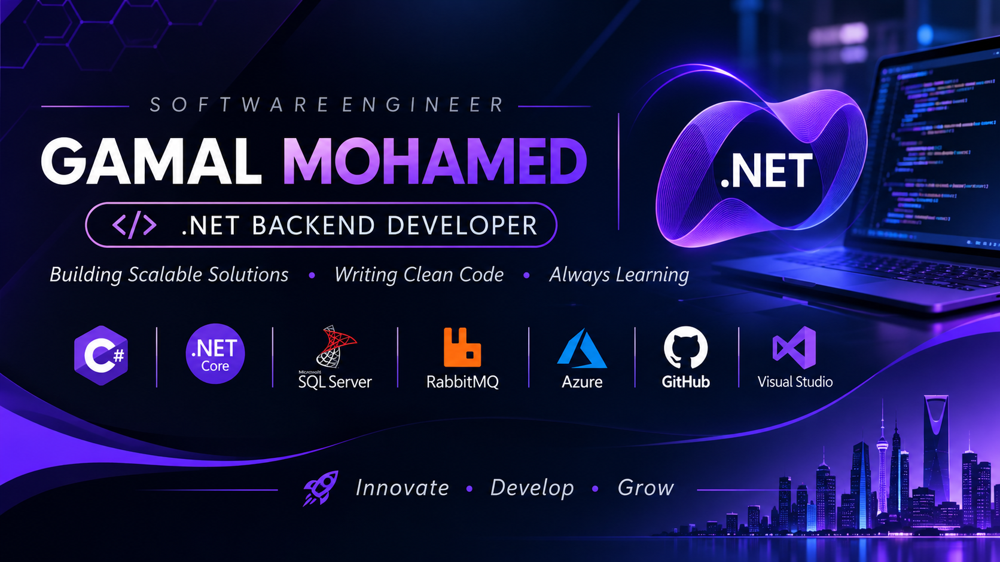

  

# Hi, I'm Gamal Mohamed 👋

### Software Engineer | .NET Backend Developer

I build scalable and maintainable backend applications using Microsoft technologies.

### 🛠️ Technical Skills

- **Languages:** C#, SQL, JavaScript
- **Backend:** ASP.NET Core, MVC, Web API
- **ORM:** Entity Framework Core, LINQ
- **Database:** SQL Server
- **Messaging:** RabbitMQ
- **Architecture:** SOLID, Clean Architecture, Design Patterns, Microservices
- **Tools:** Git, GitHub, Azure DevOps, Microsoft Azure

### 🚀 Featured Projects

- E-Commerce Marketplace – ASP.NET Core, EF Core, Microsoft Partner Center.
- RabbitMQ Messaging System – Publisher, Consumer, Exchanges, Queues, DLQ.
- Sales Dashboard – ASP.NET Core MVC, SQL Server, Chart.js.

### 📚 Currently Learning

- Microservices
- Distributed Systems
- System Design
- Advanced .NET

### 🤝 Connect With Me

- GitHub: https://github.com/GamalMo7amed
- LinkedIn: www.linkedin.com/in/gamal-mo7amed

